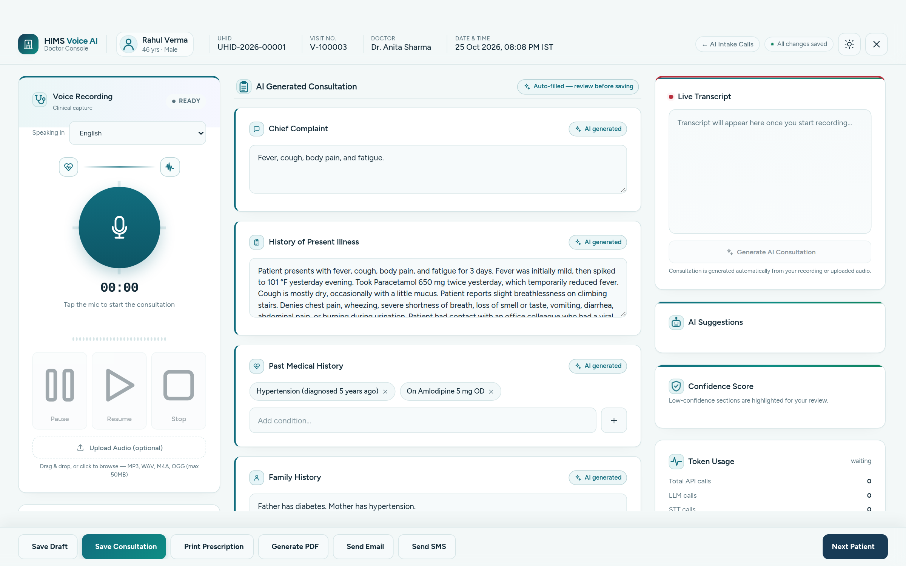
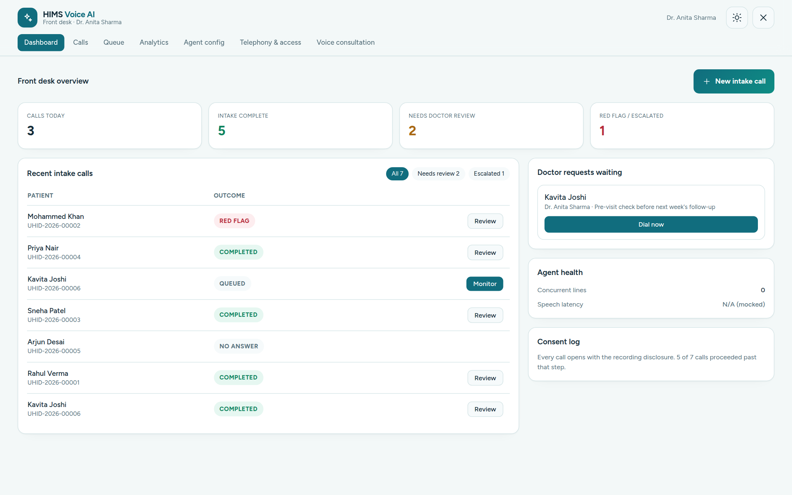
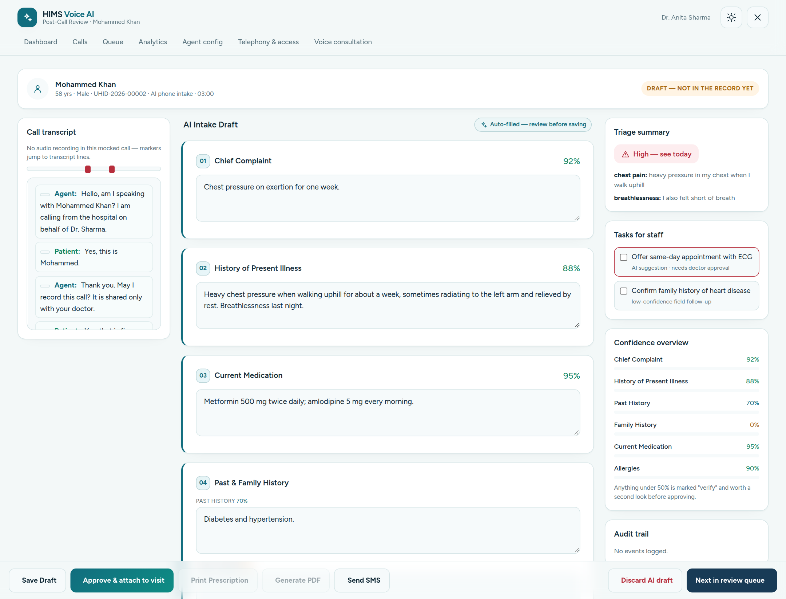
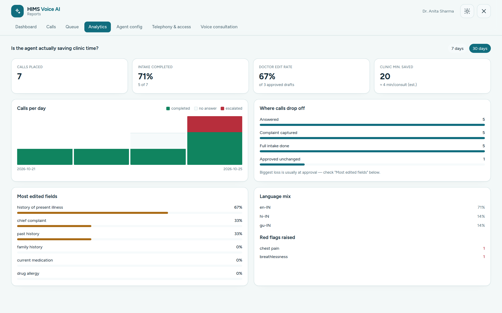
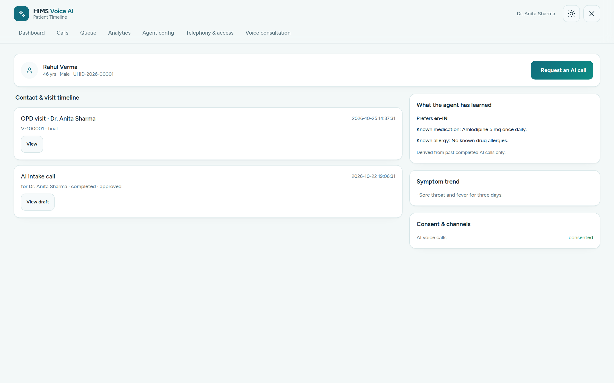
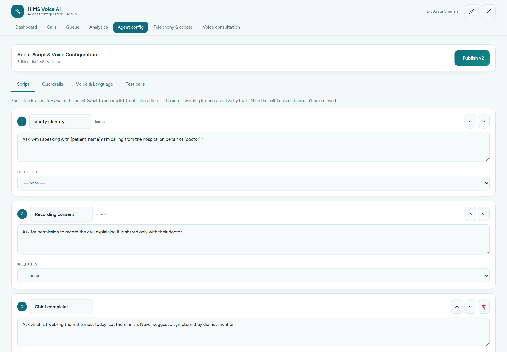
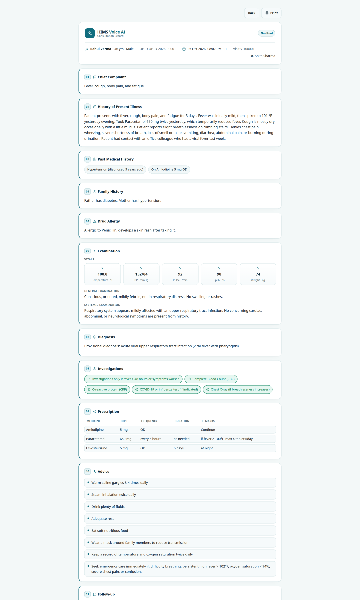
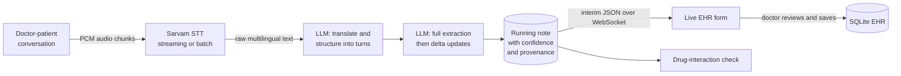

# HIMS AI: an AI-powered Health Information Management System

**An EHR that writes the clinical note while the doctor talks to the patient.**

HIMS AI is a Health Information Management System (HIMS) with an ambient AI layer. It listens to the
doctor-patient conversation, in Hindi, Gujarati, English or any other language Sarvam AI supports, and builds a
structured, editable electronic health record entry live: chief complaint, history, examination and vitals,
diagnosis with ICD-10 codes, investigations, prescription, advice and follow-up. A second AI agent phones patients
*before* the visit to collect intake information, so the doctor starts the consultation already informed.



> Demonstration project. It is not a certified medical device, every AI-generated field is a draft for the
> doctor to review, and no real patient data is included. All names in the demo data are fictional.

---

## The problem

Clinical documentation is the part of medicine nobody went to medical school for, and it is still mostly manual.

| Traditional, manual documentation | With HIMS AI |
|---|---|
| The doctor types or scribbles notes during the consult, so eye contact and attention go to the screen | The doctor just talks; the note fills itself in beside the conversation |
| Notes are finished after hours from memory, so details are lost and errors creep in | The note is built chunk by chunk during the consult and is ready for review when the patient leaves |
| Free-text notes are inconsistent and hard to search or audit | Every consult lands in the same 11-section structure, with ICD-10 diagnosis codes and a typed medication table |
| Multilingual consults are mentally translated, then typed in English | Hindi and Gujarati speech is transcribed and translated into clean English clinical text automatically |
| Front-desk staff phone patients to ask the same intake questions | An AI agent runs the intake call, flags red flags like chest pain, and hands a draft to the doctor |
| No signal on what to double-check | Per-section confidence scores and drug-interaction alerts point the doctor at what needs a second look |

The doctor stays in control. Nothing reaches the record until a human has reviewed and saved it.

## What it does

### AI clinical documentation (the doctor-patient conversation)

- **Live voice consultation**: record from the browser microphone, share a Google Meet or other tab's audio for
  teleconsultations, or upload a recorded consultation.
- **Any Indian language in, English clinical note out**: speech-to-text with Sarvam AI, then LLM translation and
  speaker structuring into alternating `Doctor:` / `Patient:` turns.
- **Structured EHR note, filled in live**: chief complaint, history of present illness, past and family history,
  drug allergy, examination with vitals, diagnosis with ICD-10, investigations, prescription, advice and follow-up.
  Every field stays editable.
- **Confidence scoring**: each section is rated by how clearly the transcript supports it, shown as colour-coded bars.
- **Drug-interaction check** on the final prescription, plus **documentation suggestions** such as "consider recording
  symptom duration".
- **Save draft or final**, restore any past visit, **print or save as PDF**, **email a real PDF** to the patient, or
  send an SMS summary.
- **Voice commands** wired to the same actions as the on-screen buttons (start and stop recording, next section,
  print, save, next patient).

### AI outbound intake calls (before the visit)

- An AI agent places a call (**telephony is mocked** in this build) to gather chief complaint, history, current
  medication and allergies.
- **Doctor-authored scripts**: a script is a list of instructions, not lines. The LLM writes the real question for each
  step within fixed safety guardrails, and always starts with identity and recording consent.
- **Live monitor** with a step tracker, red-flag alerts and staff controls to whisper guidance, hold or take over.
- **Red-flag triage**: chest pain, breathlessness, bleeding, stroke signs and suicidal intent raise a prioritised alert
  and a task for staff.
- **Doctor review before anything enters the record**: edit field by field, then approve into a visit or discard.
- **Analytics** including the doctor edit rate, which measures how often and where doctors correct the AI.

### Hospital information system basics

- Doctor and admin roles (the first account becomes admin), CSRF protection and password hashing.
- Front-desk patient registration with generated UHIDs and visit numbers.
- Per-patient timeline merging AI intake calls and visits, with medications and allergies carried forward.
- Admin tools: agent script builder with draft and publish, voice and persona settings, telephony and access settings.

## See it

| | |
|---|---|
|  **Front-desk dashboard**: live calls, requests waiting, review queue |  **Post-call review**: red-flag triage, confidence per field, edit and approve |
|  **Analytics**: completion, drop-off, language mix, doctor edit rate |  **Patient timeline**: visits and AI calls in one place |
|  **Agent script builder**: instructions, guardrails, publish |  **Consultation record**: print, PDF or email |

### From speech to structured note

Raw speech-to-text from a recorded fever and cough teleconsultation (an excerpt, errors included):

> *"...Hypertension, yeah. They diagnosed me about five years ago. I take amlodipine for it. Five mg once daily, but no asthma or thyroid disease, and no surgeries or previous hospital admissions..."*

Becomes entries in the structured record, for example:

- **Past medical history**: Hypertension (diagnosed 5 years ago); on Amlodipine 5 mg OD
- **Drug allergy**: Allergic to penicillin, develops a skin rash after taking it
- **Diagnosis**: Provisional: acute viral upper respiratory tract infection (viral fever with pharyngitis)
- **Prescription table**: Amlodipine 5 mg OD (continue); Paracetamol 650 mg every 6 hours as needed (max 4 per day);
  Levosteirizine 5 mg OD at night for 5 days (the drug is levocetirizine; the transcript and note carry the
  speech-to-text misspelling through, a good example of why the doctor reviews every note)

The complete run, with per-chunk patches, is in [`docs/examples/sample_run`](docs/examples/sample_run).

## How it works



- Audio is processed in rolling windows (120 s with 10 s overlap by default), so the note builds **during** the
  consultation. The first window produces a full extraction; later windows return only what is new or changed.
- Audio ingestion and processing are decoupled by a queue, so a slow model call never drops audio.
- The PHP application owns persistence; the Python AI service never touches the database, so models can be swapped
  without touching the record system.

More detail, including sequence diagrams and the data model, is in [docs/architecture.md](docs/architecture.md).

## Evidence: how the model choices were made

Engine and model choices came from small benchmarks kept in this repo. They use a single recorded consultation,
so read them as indicative, not conclusive.

**Speech-to-text on Gujarati speech** (`AI_backend/test_scripts/gujarati_comparison/`), end to end from audio to
clinical JSON, judged against a hand-written ground truth:

| Pipeline | Total time | Judged average (of 10) |
|---|---|---|
| Sarvam `saaras:v3` with translation | 3.2 s | 7.8 |
| Deepgram `nova-3` plus LLM translation | 46.0 s | 7.2 |

**Extraction model, human-reviewed** (`evaluations/llm_extraction/human_evaluation_summary.csv`), scores out of 10:

| Model | Rank | Accuracy | Missing info | Hallucination (10 is best) | Structuring | Latency |
|---|---|---|---|---|---|---|
| gemini-2.5-flash | 1 | 9.0 | 9.0 | 10.0 | 10.0 | 43.3 s |
| gpt-5.6-luna | 2 | 9.5 | 10.0 | 8.5 | 8.0 | 30.4 s |
| gpt-5.4-nano | 3 | 8.0 | 7.0 | 9.5 | 6.0 | 25.0 s |
| gpt-5.4-mini | 4 | 7.0 | 6.0 | 9.5 | 4.0 | 14.7 s |

An earlier STT-engine benchmark on an English clinical call is in [`evaluations/stt_benchmark/`](evaluations/stt_benchmark/).

## Tech stack

| Layer | Technology |
|---|---|
| Clinical workspace | PHP 8 (no framework, no Composer), SQLite via PDO, vanilla JS, Tailwind CSS |
| AI backend | Python 3.11+, FastAPI, WebSockets, Pydantic v2, httpx |
| Speech-to-text | Sarvam AI (streaming and batch); Deepgram, Groq Whisper and NVIDIA Parakeet benchmarked |
| LLMs | Provider-agnostic client: Gemini, OpenAI, Grok, NVIDIA, Groq, or local Ollama |
| Output | Headless Chrome for PDFs, PHPMailer over SMTP for email |
| Quality | pytest unit and integration tests, per-run JSON logging, LLM-as-judge and human evaluation |

## Quick start

You need PHP 8 with `pdo_sqlite`, and Python 3.11+. Chrome or Chromium is needed only for emailing PDFs.

**Just want to look around? No API keys needed.**

```bash
git clone https://github.com/Jugal-lachhwani/HIMS_AI_system.git
cd HIMS_AI_system
php web/scripts/seed_demo.php      # fictional doctors, patients, a saved note and intake calls
PHP_CLI_SERVER_WORKERS=4 php -c web/php.ini -S 127.0.0.1:9000 -t web/public
```

Open <http://127.0.0.1:9000> and sign in as `anita.sharma@example.com` / `demo1234` (admin).
Dashboard, call review, analytics, timeline and the saved consultation all work. Live recording and AI calls need the
backend below.

**Full stack with live AI.** In a second terminal:

```bash
cd AI_backend
python3 -m venv .venv && source .venv/bin/activate
pip install -r requirements.txt
cp .env.example .env               # add an LLM key and SARVAM_API_KEY; keep SAMPLE_RATE=24000
uvicorn app.main:app --host 127.0.0.1 --port 8001 --reload --reload-dir app
```

Then choose **Voice consultation** in the navigation, select a patient and press the microphone. Backend settings
are documented in [AI_backend/README.md](AI_backend/README.md).

To email consultations, copy `web/config/smtp-config.example.php` to `web/config/smtp-config.php` and add a Gmail App
Password. PHP's built-in server needs `PHP_CLI_SERVER_WORKERS=4` for that flow, because rendering the PDF makes a
request back to the same server.

On a fresh install the first account you register becomes the admin.

## Repository layout

```
.
├── web/                          PHP clinical workspace (the EHR)
│   ├── public/                   Web root: only this folder is served
│   │   ├── index.php             Redirects to the dashboard (or login)
│   │   ├── auth/                 login, register, logout
│   │   ├── patients/             select.php (front desk), timeline.php
│   │   ├── consultation/         workspace.php (live voice note), print.php (record / PDF source)
│   │   ├── intake/               dashboard, calls, call-monitor, call-review, queue, request-call, analytics
│   │   ├── admin/                agent-config.php, telephony.php (admin only)
│   │   ├── api/                  AJAX endpoints, grouped: consultation/, intake/, admin/
│   │   └── assets/               css/ and js/ (WebSocket clients, recording, rendering)
│   ├── includes/                 Server-side code kept outside the web root
│   │   ├── core/                 db.php (schema), auth.php, icons.php, pdf.php
│   │   ├── layout/               shared page shells and navigation
│   │   ├── consultation/         workspace panels (left, centre, right, action bar)
│   │   └── vendor/PHPMailer/     Vendored mailer (no Composer needed)
│   ├── config/                   smtp-config.example.php (copy to smtp-config.php)
│   ├── data/                     mock-data.php; hims.sqlite is created here (git-ignored)
│   ├── scripts/seed_demo.php     Fictional demo data
│   └── php.ini                   Upload limits for local development
├── AI_backend/                   FastAPI service
│   ├── app/                      config, routes, pipeline, models, llm, prompts, observing
│   ├── tests/  test_scripts/     Unit and integration tests, headless WebSocket clients
│   └── scripts/                  generate_mock_audio.py (synthetic consultation audio)
├── evaluations/                  Benchmarks and ground truth
│   ├── stt_benchmark/            Deepgram / Groq / Whisper / NVIDIA speech-to-text comparison
│   ├── llm_extraction/           Model comparison scores and per-run judge output
│   └── ground_truth.json         Reference note used by the judges
├── docs/                         architecture.md, running-locally.md, screenshots/, examples/, sample-data/, notes/
└── legacy/                       Superseded code kept for reference (see legacy/README.md)
```

## Limitations and roadmap

Stated plainly so nobody has to discover them:

- **Telephony is mocked.** No real calls are placed. Scheduling only enqueues rows, and there is no background dialler.
- **Single-clinic model.** Roles split admin from doctor, but any signed-in doctor can open any patient.
- **No patient portal.** Patients are records a doctor looks up, not accounts.
- **AI output is a draft.** Speech recognition and LLMs make mistakes, as the sample run shows. The review step is part
  of the design, not an optional extra.
- **Not compliance-ready.** There is no encryption at rest, audit logging beyond intake-call events, or
  consent-management beyond the call recording consent step. Treat it as a prototype, not a deployable HIPAA or DPDP system.
- Ideas for next steps: real telephony provider, background dialler, per-doctor data scoping, FHIR export, and
  fine-grained audit logs.
