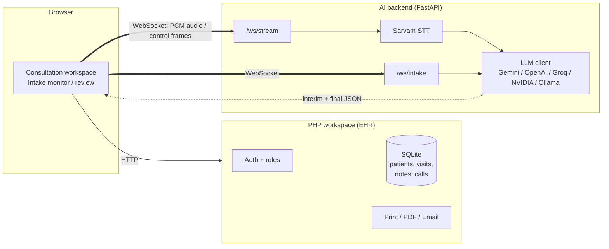
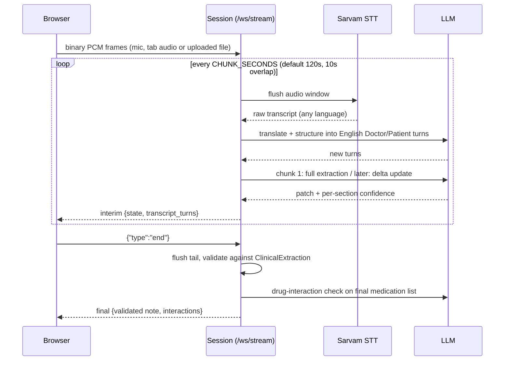
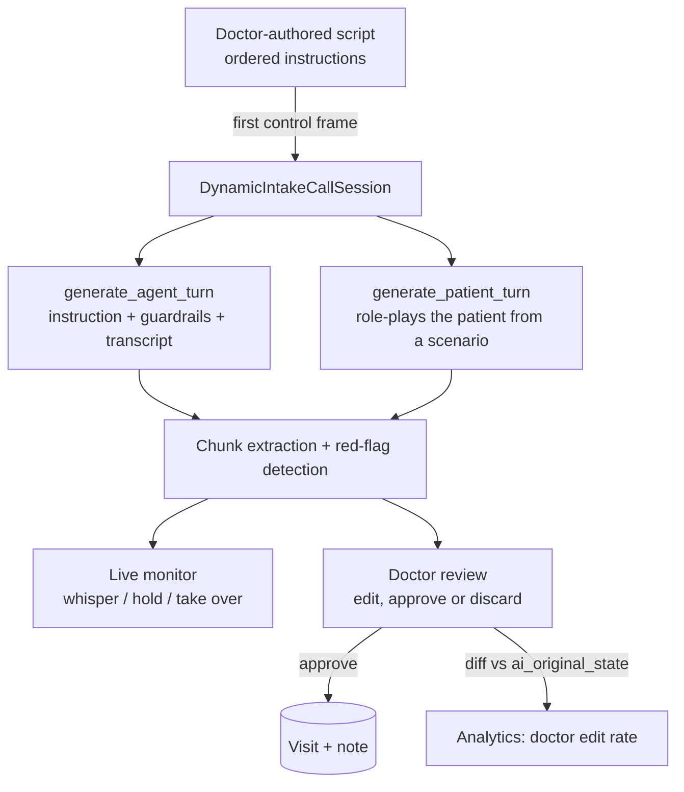
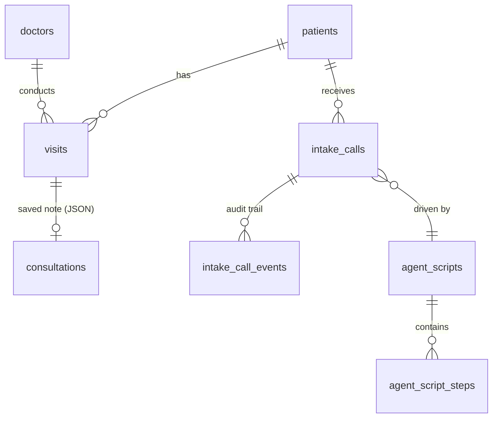

# Architecture

HIMS AI is two independent services that talk over a WebSocket:

| Service | Stack | Owns |
|---|---|---|
| **Clinical workspace** (repo root) | PHP 8, SQLite, vanilla JS, Tailwind | Accounts, patients, visits, saved notes, every screen, print/PDF/email |
| **AI backend** (`AI_backend/`) | Python 3.11+, FastAPI, Pydantic | Audio chunking, speech-to-text, LLM structuring and extraction, intake-call agent |

The browser connects **directly** to the AI backend over WebSocket
(`web/public/assets/js/ws-stream-client.js`, `web/public/assets/js/ws-intake-client.js`). PHP never calls the AI backend, and the
AI backend never reads or writes the database. PHP owns all persistence; Python is pure request/response
over the socket. That boundary keeps the model layer swappable and the record system simple.

## Streaming consultation pipeline

A consultation is processed **while it is happening**, not after the recording ends.

Design decisions worth knowing:

- **Two STT paths.** Live microphone audio uses a persistent Sarvam *streaming* connection (it can only run at
  real-time pace). Uploaded recordings arrive far faster than real time, so they use the *batch* REST adapter,
  which splits long chunks into sub-25-second segments.
- **Translation is an LLM step, not an STT step.** STT returns whatever language was spoken (Hindi, Gujarati,
  English...). The structuring prompt translates to English, so clinical extraction always sees clean English.
  Changing `SARVAM_LANGUAGE` is the only change needed to support another language.
- **Delta extraction.** Chunk 1 produces the full 11-section note. Later chunks return only what is new or changed,
  together with the model's own confidence in each changed section, which keeps prompts small and latency flat.
- **Overlap.** The last `OVERLAP_SECONDS` of audio are replayed at the start of the next chunk so words are not cut
  at boundaries; the transcript prompt is given the turns so far so overlap is not duplicated.
- **Ordered processing, decoupled ingestion.** Audio ingestion and chunk processing run as two async tasks joined by
  a queue, so a slow LLM call never blocks incoming audio. Chunks are processed strictly one at a time because each
  delta depends on the previous merged state.
- **Provenance.** `MedicalState` records which chunks contributed each field and keeps short transcript evidence.
- **Observability.** Every run writes its per-chunk transcript, raw LLM output, patch and merged state to a run
  directory (`AI_backend/.results/<run_id>/`), so any odd extraction can be replayed.

## AI outbound intake calls

Before a patient is ever seen, an AI agent can place a call (telephony is mocked) to collect chief complaint,
history, red flags, current medication and allergies. A doctor reviews the draft before anything enters the record.

- `mode=dynamic` (default): per step, one LLM call writes the agent's actual question and another simulates the
  patient's reply; both feed the same extraction path as consultations.
- `mode=fixed`: two word-for-word scripts, zero dialogue LLM calls, kept as a deterministic regression baseline.
- Safety: the agent can only fill intake sections. Examination, diagnosis and prescription stay doctor-only.
  Every call opens with a recording-consent step, and published scripts must contain one.
- Admin-only: script builder (draft, then publish; exactly one script is live) and telephony settings.

## Data model (SQLite, created automatically by `web/includes/core/db.php`)

`consultations.data` stores the same JSON shape the AI backend emits, so a note restores into the UI exactly as it was
generated and edited. `intake_calls.ai_original_state` is a snapshot taken the first time a call completes and is never
overwritten; comparing it with the doctor's saved state is what produces the edit-rate metric.

## Security notes

- Passwords hashed with `password_hash`; CSRF tokens on state-changing requests; role re-checked from the database on
  every admin request, so a demotion applies immediately.
- Saving a consultation always targets the *session's* visit, never a client-supplied ID.
- Server-side PDF rendering authenticates its one internal request with a short-lived HMAC token scoped to a single visit.
- Secrets (`.env`, `web/config/smtp-config.php`) and the database are git-ignored.
- Single-clinic assumption: any signed-in doctor can open any patient. Roles split admin from doctor, not data by doctor.
